I build systems in **Go** and **TypeScript**, from high-concurrency APIs to agentic AI pipelines, and ship tools that remove manual work inside organisations. Currently at **Grant Thornton Bharat**.

  
  
  
  

### Live

### Open source

### Play

### Stack

  
  
  
  
  
  
  
  
  
  

### Latest writing

<!-- posts:start -->
- [Nobody Clicks the Feature. That Does Not Make It Cheap to Remove.](https://blogs.tanmaybohra.com/posts/feature-retirement-dependency-cost/)
- [Two Invoice Files Can Be One Bill. One Number Can Be Two Bills.](https://blogs.tanmaybohra.com/posts/invoice-identity-aliases/)
- [The User Clicked Cancel. Did the Work Actually Stop?](https://blogs.tanmaybohra.com/posts/cancellation-stop-path/)
- [BICO Wants AI-Ready Instruments. Readiness Needs More Than an API.](https://blogs.tanmaybohra.com/posts/bico-instrument-physical-state/)
- [Molten Turns Holdings Into Cash. A Partial Exit Answers a Narrow Question.](https://blogs.tanmaybohra.com/posts/molten-partial-exit-valuation-evidence/)
<!-- posts:end -->

<picture>
  <source media="(prefers-color-scheme: dark)" srcset="https://raw.githubusercontent.com/sabaka3560/sabaka3560/output/snake-dark.svg">
  
</picture>
